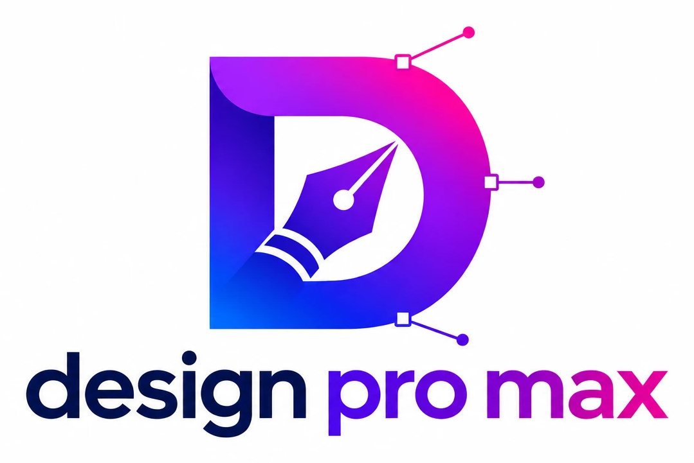

<div align="center">

<h1></h1>

### Design Skills for AI Coding Agents

*One skill per design. A router for Apple-platform work with its own HIG, launch-page, demo-clip, scroll-scene, menu bar and widget, and web-shell guides, plus spacing rhythm and an exact-icon catalog, bundled.*

<p align="center">
  <a href="https://www.npmjs.com/package/@minhspark/design-pro-max"></a>
  <a href="https://www.npmjs.com/package/@minhspark/design-pro-max"></a>
  <a href="https://www.npmcharts.com/compare/%40minhspark%2Fdesign-pro-max?minimal=true"></a>
  <br />
  <a href="https://github.com/buidangminh23/design-pro-max/network/dependents"></a>
  <a href="https://skills.sh/buidangminh23/design-pro-max"></a>
  <a href="https://github.com/buidangminh23/design-pro-max/graphs/traffic"></a>
  <a href="LICENSE"></a>
</p>

[Latest release](https://github.com/buidangminh23/design-pro-max/releases/latest) · [npm package](https://www.npmjs.com/package/@minhspark/design-pro-max) · [CI](https://github.com/buidangminh23/design-pro-max/actions/workflows/ci.yml) · [Changelog](CHANGELOG.md)

</div>

Four skills, one per design:

- **apple**: a router for Apple-platform work that sends each task to one bundled guide, either a third-party part or one of the project's own, and has the agent read that guide in full.
- **design-spacing-rhythm**: spacing, alignment and vertical rhythm for generated UI and documents, bundled from [buidangminh23/spacing-skill](https://github.com/buidangminh23/spacing-skill).
- **icons-pro-max**: an icon catalog with the exact brand logos, UI icons and render rules, bundled from [buidangminh23/icons-pro-max](https://github.com/buidangminh23/icons-pro-max).
- **uxui-prompt**: 480 interactive UI elements from [Lucian UX/UI Prompt](https://lucianlabs.dev/uxui-prompt/) (buttons, toggles, forms, sign-in, menus, cards, loaders, empty states, charts, heroes, pricing, scroll and text motion, app screens), searched and ported into a project's framework and theme. It is the MIT [lucian-uxui](https://github.com/Seokwoooo/lucian-uxui) skill by Seokwoooo with the English catalog bundled, so it works offline; see [UX/UI Prompt](#uxui-prompt).

The two bundled skills are copied byte for byte from the latest release of their own repositories and kept in step by a daily job; see [Bundled skills](#bundled-skills).

## Install

Install the `apple` skill folder into a skill root that your agent host reads:

```sh
npx skills add buidangminh23/design-pro-max --skill apple -g
```

The bundled skills install the same way, one `--skill` per skill:

```sh
npx skills add buidangminh23/design-pro-max --skill design-spacing-rhythm -g
npx skills add buidangminh23/design-pro-max --skill icons-pro-max -g
npx skills add buidangminh23/design-pro-max --skill uxui-prompt -g
```

From v0.1 the same files are on npm as `@minhspark/design-pro-max`. `npm install @minhspark/design-pro-max` puts them under `node_modules/@minhspark/design-pro-max/skills/`; copy the skill folders you want, with `apple`'s hidden `.vendor/` folder, into a skill root.

From v0.1 each release also ships `design-pro-max-vX.Y.Z.zip` with `SHA256SUMS.txt`. The ZIP holds `skills/apple` with its hidden `.vendor/` folder, which must be copied along with the rest, and the bundled skills next to it.

- A bundled skill is the same skill its own repository releases. Install it from one place only: a machine that already installs `spacing-skill` or `icons-pro-max` from their repositories would list the skill twice.

- Install only into a host's own skill roots, such as `~/.claude/skills/` for Claude Code or a user or repository skill folder of Codex. Hosts skip dot-folders there, so they list `apple` and each bundled skill you installed, and the 38 parts under `.vendor/` stay hidden.
- Never run `npx skills` with `--full-depth`: it enters dot-folders and installs every part under `.vendor/` as a skill of its own.
- Do not put the skill in a Codex executor environment's skill root, such as one of a remote or sandboxed executor: those roots include hidden folders, so every part would register as a skill.
- Use one install channel per machine. Installing with `npx skills` and copying the release into another skill root makes a host list `apple` twice.
- With a very large skill library a host may list `apple` without its description, so it will not start on its own; invoke it as `/apple` in Claude Code or `$apple` in Codex.

## Layout

```text
skills/
  apple/
    SKILL.md                 router: standing rules, routing table, parts index
    NOTICE.md                disclaimer, trademarks and the icon's source
    references/parts-index.md  generated: every part's group, activation, prerequisites and errata pointers
    agents/openai.yaml       display name and icon for Codex
    assets/apple.svg         the skill icon (the Apple logo)
    shared/                  the checker runtime the project's own parts share: report contract, MP4 reader, media check,
                             test server, fixture harness, Playwright resolver, sandbox detection and the motion classes
    launch-scroll/           own part: pinned and scroll-scrubbed scenes on web pages
      PART.md                the guide the router sends to
      references/            engines and geometry, scrub video, frame sequences, gates, generated evidence
      assets/lib/            scene progress, seek queue, scrub loader and frame window, with their CSS contract
      assets/reference/      four reference pages: JavaScript engine, CSS engine, scrub video, image sequence
      scripts/               probe-scene.mjs (browser checks), encode-scrub.mjs (scrub encoder),
                             make-sequence.mjs (image sequences), bench-scrub.mjs (advisory film-vs-sequence sweep)
    launch-page/             own part: launch and landing pages, built or reviewed
      PART.md                the guide the router sends to
      references/            type and colour, layout and components, motion and the hero intro, generated evidence
      assets/                tokens.json and the tokens.css and theme.tailwind.css generated from it
      assets/lib/            intro gate, one-shot reveals, gallery and marquee with pause controls
      assets/reference/      two CSS-drawn reference pages: a launch page and a hero intro hand-off
      scripts/               check-page.mjs (browser checks), lint-css.mjs (static check)
    launch-video/            own part: demo clips rendered from code, encoded and embedded
      PART.md                the guide the router sends to
      references/            paths and licences, direction, rendering, encode recipes, the embed component, generated evidence
      assets/lib/            demo-embed.js, the lazy clip loader with its pause control
      assets/reference/      an original UI mock, a demo embed page and generic CSS device frames
      scripts/               render-frames.mjs (frame-stepped render), encode.mjs (encode profiles), check-embed.mjs
    hig/                     own part: Apple's Human Interface Guidelines for native app interfaces
      PART.md                how to read, build to and review against the guidelines
      references/            own-words digest of every guideline page by section, with generated evidence
    menubar-widgets/         own part: macOS menu bar apps and WidgetKit widgets
      PART.md                the guide the router sends to
      references/            status items, widgets and App Intents configuration, testing and builds, generated evidence
      assets/                Swift references: a status item, a configurable widget, its bundle, stale-extension cleanup, a snapshot renderer
      scripts/               scan-swift.mjs (static Swift scan), probe-extension.mjs (read-only process probe), snapshot-widgets.mjs
    web-shells/              own part: web apps on the Home Screen and in Capacitor or Tauri shells
      PART.md                the guide the router sends to
      references/            shells and origins, sign-in and cookies, WebKit testing, generated evidence
      assets/                a login page with a session cookie, remote-shell configs for Capacitor and Tauri, a web app manifest,
                             and the offline page that is all a remote shell's webDir or frontendDist should hold
      scripts/               check-shell.mjs (the origin a shell loads), probe-webkit.mjs (WebKit sign-in and cookie probe)
    .vendor/                 third-party parts, byte-for-byte at pinned commits
      <part>/
        SKILL.md ...         upstream files, unmodified
        LICENSE              the upstream licence
        UPSTREAM.json        source, commit, prerequisites, risks, errata, Apple text, file hashes and modes
      xcode-build/<part>/
      app-store-connect/<part>/
  design-spacing-rhythm/     bundled: spacing-skill's skill folder at its release tag, plus its LICENSE
  icons-pro-max/             bundled: icons-pro-max's skill folder at its release tag, logos included, plus its LICENSE
skills.json                  generated: the skills in this repository, for installers
vendor/sources.json          the 38 parts: repository, commit, path, excludes, status
vendor/bundles.json          the bundled skills: repository, release tag, commit, licence and every file's hash
scripts/bundle-sync.mjs      sync, check and update for the bundled skills
scripts/lib/bundles.mjs      the bundle record, its checks and BUNDLED_MEDIA, the only bundles that may ship images
scripts/vendor-sync.mjs      sync, check, notices, and stage, classify, confirm and apply for upstream updates
scripts/vendor-guard.mjs     offline guard
scripts/gen.mjs              writes skills.json, the parts index, the README credits and the trademark line
scripts/check-history.mjs    keeps unreviewed images and vendored agents/ and assets/ files out of git history
scripts/release.mjs          checks, packs and verifies the release ZIP; bumps versions and card stats; pushes the tag
scripts/ci-local.mjs         runs the CI steps and the verify run locally when Actions cannot run
scripts/lint-ip.mjs          IP and privacy lint over the project's own files
scripts/lint-tokens.mjs      fails a launch-page token set that copies measured reference values
scripts/verify.mjs           runs every own-part fixture through the checkers, red first
scripts/import-findings.mjs  checks the evidence ledger's source hashes against a research folder
rules.json                   the own parts' rules: level, evidence, check, fixtures and the checker that implements each
evidence/ledger.json         own-words claims with their label, source and source hash
evidence/ip-hashes.json      salted hashes of the private identifiers, private terms and Apple text corpus
evidence/token-hashes.json   hashed measured reference values lint-tokens compares against (public measurements, recoverable)
designs/apple.json           the apple skill's design record: marks, never-ship list, phrase gates, newest released OS
designs/brand/logo.png       the project logo in this README's header (reviewed media)
designs/renders/devices/     the owner's device render, its frames, preview and outputs (reviewed media, never released)
fixtures/                    pass and fail cases for every error rule, with pages and a planted-defect launch page; media is built at run time
evals/                       routing and part evals, the harness that runs them on Claude Code and Codex, and RESULTS.md
test/                        the test suite npm test runs, with its fixtures
.github/workflows/           CI, release, the weekly vendor sync and the own-part verify run
package.json                 the npm package: name, version, description and the files it ships
web-card.json                the project card: taglines, descriptions and the stats release.mjs computes
THIRD_PARTY_NOTICES.md       generated credits with every licence text
CONTRIBUTING.md              issues first, MIT-only sources, how a part is added
```

### Why `.vendor` is hidden

Agent hosts register every `SKILL.md` they find. Codex scans skill folders recursively but skips dot-directories, and Claude Code registers only the direct children of a skills folder. With every vendored part inside the hidden `.vendor/` folder, both hosts list `apple` as one skill, while every vendored file stays byte-identical to upstream: nothing is renamed or edited to hide them.

The same constraint shapes the rest of the tree: each skill's own `skills/<name>/SKILL.md` is the only `SKILL.md` outside dot-directories, there are no symlinks, no `.claude-plugin` or `.codex-plugin` folder sits inside `skills/apple`, no folder is named `.claude`, `.agents`, `.codex` or `.git`, and no file is named `metadata.json`, which some installers drop. `.gitattributes` marks `skills/apple/.vendor/**` and the bundled skill folders as `-text`, so git never rewrites vendored or bundled line endings.

## Parts

The router reads a part's `SKILL.md` in full, resolves each relative path a part mentions against the folder of the file that mentions it (then the part's own folder), checks inactive parts' activation first, and applies the errata recorded in its `UPSTREAM.json`.

### Own parts (6)

Written for this project and released under its MIT licence. Each has a `PART.md` guide; a part with checkers has error rules in `rules.json` that they enforce, and a pass and a fail fixture for every error rule.

| Part | Covers | Prerequisites |
|---|---|---|
| `launch-scroll` | Pinned scroll scenes and scroll-scrubbed video or frame sequences on web pages: when not to pin, the engine, geometry, gates for reduced motion, short viewports and blocked autoplay, scrub encoding and the start frame. 8 error rules and 9 warnings | Node 22 or later; ffmpeg and ffprobe for media checks and encoding; Playwright with Chromium in the user's project for browser checks |
| `launch-page` | Launch and landing pages (hero, feature tiles, galleries and marquees, pricing, FAQ), built on the part's own restrained or expressive token sets and the user's brand, or reviewed read-only: no SF fonts on the web, text in normal flow without JavaScript or motion, sizes from one token set, contrast on the real background, pause controls for self-moving content, a hero intro that always ends and reveals that stay. 7 error rules and 9 warnings | Node 22 or later; Playwright with Chromium in the user's project for browser checks |
| `launch-video` | Demo clips rendered from code, never screen recordings: whether a still or a live replica is enough, an HTML and CSS rebuild of the UI rendered frame by frame at 2x, H.264, VP9, AV1 and transparent encodes with a frame-0 start image, and a lazy embed that starts late, plays one clip at a time and can be paused. 7 error rules and 8 warnings | Node 22 or later; ffmpeg and ffprobe; Playwright with Chromium in the user's project; macOS outside an agent sandbox for HEVC with alpha |
| `menubar-widgets` | macOS menu bar apps and WidgetKit widgets: whether a menu or a window is enough, status items that redraw only when light or dark changes, Edit Widget options through AppIntentConfiguration, stale extension processes after a self-update, offscreen widget snapshots with byte baselines, and testing beside the installed copy. 5 error rules and 6 warnings | Node 22 or later; on macOS, Swift for the snapshot checks (they skip elsewhere); `ps` and `lsof` for the read-only probe |
| `web-shells` | Web apps on iPhone, iPad and Mac: a home-screen web app or a Capacitor or Tauri shell, the origin a built shell really loads, sign-in with a login page and a session cookie instead of HTTP Basic Auth, and cookies in WebKit tests. 5 error rules and 4 warnings | Node 22 or later; Playwright with WebKit in the user's project for the probe; openssl for its local HTTPS server |
| `hig` | Apple's Human Interface Guidelines for native app interfaces on iOS, iPadOS, macOS, watchOS, tvOS and visionOS: an own-words digest of all 158 guideline pages (platforms, foundations, patterns, components, inputs, technologies), each section linked to its page, with a build checklist and a review table that states its proof boundary. Numbered claims cite the ledger | None; the Simulator's Accessibility Inspector, or a device, for the checks code cannot prove |

Known limit, measured in `evals/RESULTS.md`: on Claude Code, apple started on 45 of the 53 routing rows at high effort (the bar is 90 %) and on 40 at medium; for plain knowledge questions such as Swift 6 migration or Swift Testing, Claude Code often answers without starting a skill. Start it by name with `/apple` when the answer should follow this skill. Codex started it on all 53.

Known limit, measured in `evals/RESULTS.md`: asked for a scroll-scrub film in AV1 or HEVC only, Codex reads the part's rule and still delivers those codecs alone, recommending H.264 only in its advice; Claude Code adds the H.264 source. Check the delivered `<source>` list with `skills/apple/shared/check-media.mjs` before shipping.

The checkers print one JSON line per finding and a summary that states what they prove and what they do not. They exit 0 when every check passes, 1 on an error, 2 when an argument or a tool is missing, and 3 when a sandbox blocks the browser or ffmpeg. The browser checkers (`probe-scene`, `bench-scrub`, `check-page`, `check-embed`, `render-frames` and `probe-webkit`) load Playwright from the project passed with `--project`. `check-shell` reads that project's configs with no browser; the static and ffmpeg checkers, and the menubar-widgets checkers, accept `--project` and ignore it, and need no Playwright. No checker installs anything or fetches third-party pages.

### Vendored, active (6)

| Part | Covers | Prerequisites |
|---|---|---|
| `swiftui-expert-skill` | Writing, reviewing and migrating SwiftUI for iOS and macOS, including performance traces | None; traces need python3 and Xcode's xctrace |
| `swift-concurrency` | Data-race and Sendable diagnosis, Swift 6 migration plans | The module's concurrency build settings |
| `swift-testing-pro` | Swift Testing reviews, XCTest migration, traits, parameterized and async tests | A Swift toolchain with Swift Testing |
| `swiftdata-pro` | SwiftData models, queries, predicates, indexes, CloudKit | A SwiftData project |
| `core-data-expert` | Core Data stacks, fetches, saving, threading, migrations, CloudKit | A Core Data project |
| `xcode-disk-cleanup` | Auditing and reclaiming Xcode and simulator disk space | Xcode command line tools and python3 |

### Vendored, inactive until their prerequisites exist (32)

An inactive part stays in the tree in full. The router runs its activation check first and stops with the missing prerequisites when the check fails.

| Group | Parts | Activation |
|---|---|---|
| Xcode build optimization | `xcode-build/xcode-build-orchestrator`, `xcode-build-benchmark`, `xcode-build-fixer`, `xcode-compilation-analyzer`, `xcode-project-analyzer`, `spm-build-analysis` | An `.xcodeproj` or `.xcworkspace` with a scheme (`xcodebuild -list` lists one) |
| Tuist menu bar apps | `macos-menubar-tuist-app` | `Tuist.swift` and `Project.swift` in the project and `tuist version` succeeds |
| App Store Connect | 25 `app-store-connect/asc-*` parts | `asc` on PATH, `asc auth status --validate` passes, and a paid Apple Developer Program account; Apple Ads, RevenueCat and Wall of Apps parts add their own checks |

Main risks, all gated by the router: the build parts run `xcodebuild clean` and can delete a passed DerivedData folder; the App Store Connect parts can upload, submit for review, change prices, spend money on Apple Ads, revoke certificates or open a public pull request, so the router shows the exact command and waits for an explicit yes before any of these, sets `ASC_TELEMETRY_DISABLED=1` before running `asc`, and never runs `asc install-skills`. Every part's prerequisites, risks and errata are listed in `vendor/sources.json` and in its `UPSTREAM.json`.

## Bundled skills

Whole skills that the owner releases from their own repositories, shipped here unchanged so one install brings them along. `vendor/bundles.json` pins each to a release tag and its commit and records every file's size and hash; nothing in a bundled folder is edited here.

<!-- gen:bundles -->

| Skill | Repository | Release | Commit | Files | Images |
|---|---|---|---|---|---|
| `design-spacing-rhythm` | [buidangminh23/spacing-skill](https://github.com/buidangminh23/spacing-skill) | [v2.20.3](https://github.com/buidangminh23/spacing-skill/releases/tag/v2.20.3) | `f8c179ce64c9` | 8 | none |
| `icons-pro-max` | [buidangminh23/icons-pro-max](https://github.com/buidangminh23/icons-pro-max) | [v2.4.0](https://github.com/buidangminh23/icons-pro-max/releases/tag/v2.4.0) | `f197f6b78c9b` | 827 | 825 brand images, outside the MIT licence |

<!-- /gen:bundles -->

- `node scripts/bundle-sync.mjs sync` fetches each pinned commit, proves that the release tag still points at it, and copies the skill folder with the repository's licence as `LICENSE`. It refuses symlinks, submodules, unsafe names, git metadata, `metadata.json`, a second visible `SKILL.md`, and any image, font, media file or archive except the images `BUNDLED_MEDIA` in `scripts/lib/bundles.mjs` allows: `.svg` and `.png` files under `icons-pro-max`'s `assets/` folder.
- The history check and the release check accept a bundled image only with the bytes `vendor/bundles.json` records for it at the same commit, so a logo changed by hand fails like any unreviewed image.
- The **Bundle sync** workflow moves each bundle to its repository's latest release; to move one by hand, run `node scripts/bundle-sync.mjs update --only <name>`, then `gen`, `notices` and the checks.

## UX/UI Prompt

`skills/uxui-prompt/` is third-party work under the MIT License, kept with its `LICENSE` and a `NOTICE.md` that lists every change.

- `SKILL.md`, `references/porting.md` and `scripts/lucian-uxui.mjs` come from [Seokwoooo/lucian-uxui](https://github.com/Seokwoooo/lucian-uxui). The skill is renamed `uxui-prompt`, so it does not clash with `lucian-uxui` installed from its own repository, and the CLI has three marked changes that read the bundled data before the network.
- `data/api/v1/` holds `index.json` and the English catalog, tokens and all 480 elements of [Seokwoooo/lucian-uxui-prompt](https://github.com/Seokwoooo/lucian-uxui-prompt), byte for byte from the commit pinned in `vendor/uxui-prompt.json`, which records every file's size and hash. Korean copy (`--lang ko`) and `--refresh` still go to the network.
- Elements keep their first-line licence comment, and the skill tells the agent to keep it at the top of every file it builds from one. The vendor guard accepts the zero-width spaces three elements use in their scripts and the sample addresses in their demo copy only under `data/`.
- `node scripts/uxui-sync.mjs check` verifies the data offline in CI; `sync` refetches the pinned commit and `update` moves the pin to the repository's head. The **Bundle sync** workflow runs `update` daily.

## Credits

Every vendored part is MIT-licensed and every vendored file is unmodified. The excludes in `vendor/sources.json` leave out a nested plugin copy, a plugin manifest, agent UI metadata (`agents/openai.yaml`) and icon images, some of which reproduce Apple's Swift logo, so no vendored image ships; the images in a release are the apple skill's own icon, `skills/apple/assets/apple.svg`, whose drawing is devicon's (MIT, licence in `skills/apple/NOTICE.md` and `THIRD_PARTY_NOTICES.md`), and the brand logos of the bundled `icons-pro-max` skill (see [Bundled skills](#bundled-skills)). Short passages that a part quotes from Apple, such as a sentence of Apple documentation, WWDC session titles, a few phrases or a short code listing, belong to Apple and are not covered by the MIT licences; each part lists the known ones, with their sources, under `appleText` in its `UPSTREAM.json`. Thanks to the authors. Full licence texts are in [`THIRD_PARTY_NOTICES.md`](THIRD_PARTY_NOTICES.md).

<!-- gen:credits -->

| Part | Author | Repository | Commit | Licence |
|---|---|---|---|---|
| `swiftui-expert-skill` | Antoine van der Lee | [AvdLee/SwiftUI-Agent-Skill](https://github.com/AvdLee/SwiftUI-Agent-Skill) | `204dba7c6725` | MIT |
| `swift-concurrency` | Antoine van der Lee | [AvdLee/Swift-Concurrency-Agent-Skill](https://github.com/AvdLee/Swift-Concurrency-Agent-Skill) | `d5770817d262` | MIT |
| `swift-testing-pro` | Paul Hudson | [twostraws/Swift-Testing-Agent-Skill](https://github.com/twostraws/Swift-Testing-Agent-Skill) | `2d6bba14a3c8` | MIT |
| `swiftdata-pro` | Paul Hudson | [twostraws/SwiftData-Agent-Skill](https://github.com/twostraws/SwiftData-Agent-Skill) | `8051f177a007` | MIT |
| `core-data-expert` | Antoine van der Lee | [AvdLee/Core-Data-Agent-Skill](https://github.com/AvdLee/Core-Data-Agent-Skill) | `855ca7d0df50` | MIT |
| `xcode-disk-cleanup` | Antoine van der Lee | [AvdLee/Xcode-Disk-Cleanup-Agent-Skill](https://github.com/AvdLee/Xcode-Disk-Cleanup-Agent-Skill) | `304e86e619ac` | MIT |
| `xcode-build/xcode-build-orchestrator` | Antoine van der Lee | [AvdLee/Xcode-Build-Optimization-Agent-Skill](https://github.com/AvdLee/Xcode-Build-Optimization-Agent-Skill) | `6bd7b596cd68` | MIT |
| `xcode-build/xcode-build-benchmark` | Antoine van der Lee | [AvdLee/Xcode-Build-Optimization-Agent-Skill](https://github.com/AvdLee/Xcode-Build-Optimization-Agent-Skill) | `6bd7b596cd68` | MIT |
| `xcode-build/xcode-build-fixer` | Antoine van der Lee | [AvdLee/Xcode-Build-Optimization-Agent-Skill](https://github.com/AvdLee/Xcode-Build-Optimization-Agent-Skill) | `6bd7b596cd68` | MIT |
| `xcode-build/xcode-compilation-analyzer` | Antoine van der Lee | [AvdLee/Xcode-Build-Optimization-Agent-Skill](https://github.com/AvdLee/Xcode-Build-Optimization-Agent-Skill) | `6bd7b596cd68` | MIT |
| `xcode-build/xcode-project-analyzer` | Antoine van der Lee | [AvdLee/Xcode-Build-Optimization-Agent-Skill](https://github.com/AvdLee/Xcode-Build-Optimization-Agent-Skill) | `6bd7b596cd68` | MIT |
| `xcode-build/spm-build-analysis` | Antoine van der Lee | [AvdLee/Xcode-Build-Optimization-Agent-Skill](https://github.com/AvdLee/Xcode-Build-Optimization-Agent-Skill) | `6bd7b596cd68` | MIT |
| `app-store-connect/asc-cli-usage` | Rudrank Riyam | [rorkai/app-store-connect-cli-skills](https://github.com/rorkai/app-store-connect-cli-skills) | `0915e9da1016` | MIT |
| `app-store-connect/asc-id-resolver` | Rudrank Riyam | [rorkai/app-store-connect-cli-skills](https://github.com/rorkai/app-store-connect-cli-skills) | `0915e9da1016` | MIT |
| `app-store-connect/asc-app-create-ui` | Rudrank Riyam | [rorkai/app-store-connect-cli-skills](https://github.com/rorkai/app-store-connect-cli-skills) | `0915e9da1016` | MIT |
| `app-store-connect/asc-signing-setup` | Rudrank Riyam | [rorkai/app-store-connect-cli-skills](https://github.com/rorkai/app-store-connect-cli-skills) | `0915e9da1016` | MIT |
| `app-store-connect/asc-xcode-build` | Rudrank Riyam | [rorkai/app-store-connect-cli-skills](https://github.com/rorkai/app-store-connect-cli-skills) | `0915e9da1016` | MIT |
| `app-store-connect/asc-build-lifecycle` | Rudrank Riyam | [rorkai/app-store-connect-cli-skills](https://github.com/rorkai/app-store-connect-cli-skills) | `0915e9da1016` | MIT |
| `app-store-connect/asc-testflight-orchestration` | Rudrank Riyam | [rorkai/app-store-connect-cli-skills](https://github.com/rorkai/app-store-connect-cli-skills) | `0915e9da1016` | MIT |
| `app-store-connect/asc-crash-triage` | Rudrank Riyam | [rorkai/app-store-connect-cli-skills](https://github.com/rorkai/app-store-connect-cli-skills) | `0915e9da1016` | MIT |
| `app-store-connect/asc-analytics-reports` | Rudrank Riyam | [rorkai/app-store-connect-cli-skills](https://github.com/rorkai/app-store-connect-cli-skills) | `0915e9da1016` | MIT |
| `app-store-connect/asc-submission-health` | Rudrank Riyam | [rorkai/app-store-connect-cli-skills](https://github.com/rorkai/app-store-connect-cli-skills) | `0915e9da1016` | MIT |
| `app-store-connect/asc-release-flow` | Rudrank Riyam | [rorkai/app-store-connect-cli-skills](https://github.com/rorkai/app-store-connect-cli-skills) | `0915e9da1016` | MIT |
| `app-store-connect/asc-metadata-sync` | Rudrank Riyam | [rorkai/app-store-connect-cli-skills](https://github.com/rorkai/app-store-connect-cli-skills) | `0915e9da1016` | MIT |
| `app-store-connect/asc-localize-metadata` | Rudrank Riyam | [rorkai/app-store-connect-cli-skills](https://github.com/rorkai/app-store-connect-cli-skills) | `0915e9da1016` | MIT |
| `app-store-connect/asc-whats-new-writer` | Rudrank Riyam | [rorkai/app-store-connect-cli-skills](https://github.com/rorkai/app-store-connect-cli-skills) | `0915e9da1016` | MIT |
| `app-store-connect/asc-aso-audit` | Rudrank Riyam | [rorkai/app-store-connect-cli-skills](https://github.com/rorkai/app-store-connect-cli-skills) | `0915e9da1016` | MIT |
| `app-store-connect/asc-screenshot-resize` | Rudrank Riyam | [rorkai/app-store-connect-cli-skills](https://github.com/rorkai/app-store-connect-cli-skills) | `0915e9da1016` | MIT |
| `app-store-connect/asc-shots-pipeline` | Rudrank Riyam | [rorkai/app-store-connect-cli-skills](https://github.com/rorkai/app-store-connect-cli-skills) | `0915e9da1016` | MIT |
| `app-store-connect/asc-notarization` | Rudrank Riyam | [rorkai/app-store-connect-cli-skills](https://github.com/rorkai/app-store-connect-cli-skills) | `0915e9da1016` | MIT |
| `app-store-connect/asc-ad-hoc-distribution` | Rudrank Riyam | [rorkai/app-store-connect-cli-skills](https://github.com/rorkai/app-store-connect-cli-skills) | `0915e9da1016` | MIT |
| `app-store-connect/asc-workflow` | Rudrank Riyam | [rorkai/app-store-connect-cli-skills](https://github.com/rorkai/app-store-connect-cli-skills) | `0915e9da1016` | MIT |
| `app-store-connect/asc-apple-ads` | Rudrank Riyam | [rorkai/app-store-connect-cli-skills](https://github.com/rorkai/app-store-connect-cli-skills) | `0915e9da1016` | MIT |
| `app-store-connect/asc-ppp-pricing` | Rudrank Riyam | [rorkai/app-store-connect-cli-skills](https://github.com/rorkai/app-store-connect-cli-skills) | `0915e9da1016` | MIT |
| `app-store-connect/asc-subscription-localization` | Rudrank Riyam | [rorkai/app-store-connect-cli-skills](https://github.com/rorkai/app-store-connect-cli-skills) | `0915e9da1016` | MIT |
| `app-store-connect/asc-revenuecat-catalog-sync` | Rudrank Riyam | [rorkai/app-store-connect-cli-skills](https://github.com/rorkai/app-store-connect-cli-skills) | `0915e9da1016` | MIT |
| `app-store-connect/asc-wall-submit` | Rudrank Riyam | [rorkai/app-store-connect-cli-skills](https://github.com/rorkai/app-store-connect-cli-skills) | `0915e9da1016` | MIT |
| `macos-menubar-tuist-app` | Thomas Ricouard | [Dimillian/Skills](https://github.com/Dimillian/Skills) | `05ba982bfeb0` | MIT |

<!-- /gen:credits -->

## Maintenance

Node 22 or later; no dependencies.

| Command | What it does |
|---|---|
| `node scripts/vendor-sync.mjs sync [--only <id>] [--force]` | Fetches each pinned repository once (a shallow git fetch by commit), copies every part's tracked files byte for byte with their executable bits, adds the upstream licence and writes `UPSTREAM.json`. Parts that already match only get their metadata refreshed, so a repeated sync is offline. It refuses to start while `.vendor/` holds a symlink or special file, never writes outside the real `.vendor/` folder, and refuses upstream symlinks, submodules, nested git metadata files, images, media, fonts, archives, names outside plain ASCII and names that differ only in case from the `LICENSE` or `UPSTREAM.json` it writes; exclude those in `vendor/sources.json` |
| `node scripts/vendor-sync.mjs check` | Offline: every part's files and executable bits match its `UPSTREAM.json` and the manifest, `appleText` entries name shipped files and existing lines, and nothing else, including symlinks and special files, sits in `.vendor/` |
| `node scripts/vendor-sync.mjs notices [--check]` | Regenerates `THIRD_PARTY_NOTICES.md`, or fails when it is out of date |
| `node scripts/vendor-sync.mjs stage --out <dir>` | Network. Reads each source's upstream HEAD with `git ls-remote` and stops when every source is at its pin. For a source that moved, a blobless clone proves that the pin is an ancestor of the new HEAD; then its parts are copied at the new HEAD the way `sync` copies them, include path minus excludes, into `<dir>` with the new manifest and `report.json`. A source whose history was rewritten, or whose parts no longer sync, for example because its licence is no longer MIT, is blocked and stays at its pin |
| `node scripts/vendor-sync.mjs classify --from <dir> [--json \| --markdown]` | Offline. Compares a staged update with the tree: `safe` only when no file that ships in a moved part changes, so the pins move past upstream commits that touched nothing in the parts; any added, removed or edited file, executable bit, licence or skill name makes it `needs-review`, because agents read and run these files with the user's permissions and no pattern can prove new text safe. Each reason names the file, and the added lines of each changed text file are listed with what they bring: links by host and path, commands, injection phrases, words that mix scripts and fenced code. `--markdown` prints the pull request body |
| `node scripts/vendor-sync.mjs confirm --from <dir>` | Network. Proves a staged update came from upstream: each moved source's staged commit must be on its default branch and descend from the pin, and every moved part must match a fresh copy made at that commit, record for record |
| `node scripts/vendor-sync.mjs apply --from <dir>` | Copies a staged update into the tree after refusing symlinks, special files, paths outside the moved parts and any manifest change other than commits; executable bits come from each part's `UPSTREAM.json` |
| `node scripts/gen.mjs [--check]` | Writes `skills.json`, `skills/apple/references/parts-index.md`, each own part's `references/evidence.md`, launch-page's `tokens.css` and `theme.tailwind.css` from its `tokens.json`, the README credits table, the trademark line in this README and in `skills/apple/NOTICE.md`, and the licences of the third-party drawings the skill ships (`MEDIA_NOTICES` in `scripts/lib/media.mjs`) in `skills/apple/NOTICE.md`, from the skill folders and `vendor/sources.json`; `--check` fails when one is out of date. Only the lines between `<!-- gen:<name> -->` markers are generated. The trademark line names the Apple marks that the project's own shipped text uses, the Apple logo while the skill ships it, and Cisco's IOS sentence when iOS is named |
| `node scripts/vendor-guard.mjs [--json]` | Offline guard over what git would ship: MIT licences, part files, sizes, file system entries, file types and signatures, UTF-8, names, hidden Unicode, secrets, skill layout and personal data in the project's own files; risky command patterns are reported as warnings |
| `node scripts/bundle-sync.mjs sync [--only <name>]` | Network. Fetches each bundle's pinned commit, proves its release tag points at it, copies its skill folder byte for byte into `skills/<name>/` with the repository's licence as `LICENSE`, and records every file in `vendor/bundles.json` |
| `node scripts/bundle-sync.mjs check` | Offline: each bundled folder holds exactly the files `vendor/bundles.json` records, with their sizes, hashes and executable bits, plus its `LICENSE` |
| `node scripts/bundle-sync.mjs update [--only <name>] [--report <file>]` | Network. Reads each repository's latest release from `/releases/latest`, moves the bundles whose tag changed and syncs them; the report lists what moved |
| `node scripts/check-history.mjs` | Fails when any commit reachable from HEAD adds an image, font, media file or archive, recognised by extension or by its first bytes, other than a reviewed file with its reviewed bytes (`REVIEWED_MEDIA` in `scripts/lib/media.mjs`: `skills/apple/assets/apple.svg`, `designs/brand/logo.png` and five files of the device render under `designs/renders/devices/`) or a bundled image that `vendor/bundles.json` at the same commit records with those bytes, or any file in a vendored part's `assets/` or `agents/` folder. It needs the full history, so it fails in a shallow clone |
| `node scripts/release.mjs check [vX.Y.Z]` | Validates the release inputs: the payload exists, `skills.json` is current, `.gitattributes` marks exactly the repo-only paths `export-ignore`, every top-level item is either payload or repo-only, and `package.json` names the private package `design-pro-max` before 0.1.0 and a public `@<scope>/design-pro-max` package from 0.1.0 on. With a tag, the tag must match the `package.json` version, `[Unreleased]` must be empty, the newest CHANGELOG entry must be that version, dated, with notes, and the README must have dropped the pre-release banner |
| `node scripts/release.mjs notes vX.Y.Z` | Prints the CHANGELOG notes of that version |
| `node scripts/release.mjs pack [vX.Y.Z]` | Builds `dist/design-pro-max-vX.Y.Z.zip` from a clean HEAD (the tag's commit when a tag is given) with git archive under `TZ=UTC`, so the bytes do not depend on the packer's time zone, plus `dist/SHA256SUMS.txt` naming it, then verifies both against HEAD, even when the version's tag already exists. The ZIP holds one `design-pro-max-vX.Y.Z/` folder with `skills/` (the hidden `.vendor/` folders included), `skills.json`, `README.md`, `LICENSE`, `THIRD_PARTY_NOTICES.md` and `CHANGELOG.md`; everything else is `export-ignore` |
| `node scripts/release.mjs verify <dir>` | Checks release assets, such as a downloaded release, against the installers' contract: `SHA256SUMS.txt` names exactly one ZIP, without "plugin" in its name, and its hash matches; the ZIP holds one `SKILL.md` outside dot-folders per skill in `skills.json`, every vendored file with the hash in its `UPSTREAM.json`, one MIT `LICENSE` per part and exactly the parts of `vendor/sources.json`, no entry name over 150 characters, and no symlinks, `__pycache__` folders, compiled Python, `metadata.json` files or media other than reviewed files. It also compares the ZIP with the tracked files of the tag `vX.Y.Z` (or of HEAD before the tag exists): every tracked payload file with its exact bytes and executable bit, and nothing else, so a nested `.gitattributes`, `.git/info/attributes`, `export-subst` or a line-ending filter cannot drop or rewrite a file |
| `node scripts/release.mjs stats` | Prints the card stats computed from the committed files: guides (own and vendored parts), active guides, error rules with at least one non-inferred ledger entry, must-fail fixtures, eval cases in `evals/<suite>/cases.json` and `evals/<design>/<part>/evals.json` and dated ledger claims. `check` fails when `web-card.json` shows other values |
| `node scripts/release.mjs bump X.Y.Z` | Writes the version into `package.json` and the plugin manifests that exist, and the computed stats into `web-card.json` |
| `node scripts/release.mjs push-tag vX.Y.Z` | Creates the annotated tag on HEAD once HEAD is `origin/main`, the tree is clean and `check vX.Y.Z` passes; pushes the tag by name, retries up to three times, and succeeds only when `git ls-remote` lists the tag at HEAD |
| `node scripts/badges.mjs <dir>` | Network. Writes the README badges into `<dir>`: `github-views.svg` from the GitHub traffic API, which needs `ANALYTICS_TOKEN` with Administration read on the repository, and the npm download badges once `package.json` names a public package. `BADGE_SOURCES` limits the sources, for example `views`. A source that has no data yet is skipped and leaves the published badge in place; a rejected request fails the run |
| `node scripts/ci-local.mjs [--skip-verify] [--json]` | Runs every step of CI's test job in order, read from `ci.yml`, then `scripts/verify.mjs` when ffmpeg, ffprobe and Playwright are installed, and lists what the run did not cover: the OS and Node matrix, L2 media, the GitHub-side release and sync steps, and verify when it could not run. For use when GitHub Actions is unavailable |
| `node scripts/verify.mjs [--only <case or rule>[,<more>]] [--keep] [--json]` | Copies `shared/` and each own part outside the repository, builds the fixture media with ffmpeg, serves every case and runs the part's checkers on it. A fail case passes only when its checker exits 1 with an error for the case's rule; a pass case only when the checker passes that rule without skipping it. A case with an expected file, such as the planted-defect launch page, must also report exactly the error rules that file lists for its checker. Exits 2 when ffmpeg or Playwright is missing; install Playwright with `npm install --no-save --no-package-lock playwright` and `npx playwright install chromium`. The web-shells cases also need WebKit (`npx playwright install webkit`) and openssl; the menubar-widgets snapshot cases need Swift on macOS and are listed as skipped elsewhere |
| `node scripts/lint-tokens.mjs [<file.css> ...] [--json]` | Fails a token set that matches 3 or more of the measured reference values within 1 px or 0.001 em; by default it lints the shipped `tokens.css` and `theme.tailwind.css`, each mode and `:lang()` set on its own. The measured values sit hashed in `evidence/token-hashes.json` so the file is not a copyable token sheet; they are public measurements and the hashes can be reversed. Runs inside `npm test` |
| `node scripts/import-findings.mjs --check <research folder>` | Recomputes each ledger entry's source hash from the private research folder it was written from and fails on any difference; `--write` records new hashes. The research folder never enters the repository |
| `npm test` | The test suite, including sync runs against local fake upstream repositories, the evidence ledger and rules, the citation lint, the own-part checkers' pure code and a red-first check of the harness |

To change a pin, edit `vendor/sources.json`, run `sync`, `check`, `notices`, `gen` and the guard, and review the upstream diff before committing.

### Workflows

- **CI** (`.github/workflows/ci.yml`) runs on pushes to `main`, on pull requests and by hand, on Ubuntu, macOS and Windows with Node 22 and 24: the tests, `vendor-sync.mjs check`, `bundle-sync.mjs check`, the guard, `notices --check`, `gen.mjs --check`, `check-history.mjs`, `release.mjs check` and `release.mjs pack`.
- **Verify** (`.github/workflows/verify.yml`) runs on pushes to `main` and pull requests that touch the shared runtime, an own part with checkers, `rules.json`, the evidence or the fixtures, by hand, and from the Release workflow on the tag being released. One job runs `node scripts/verify.mjs` on Ubuntu with ffmpeg, Playwright's headless Chromium and WebKit, every fixture judged red first; a second job on macOS runs the MW-SNAP-01 and MW-SNAP-02 snapshot cases with Swift and fails when any of them is skipped.
- **Release** (`.github/workflows/release.yml`) runs when a `vX.Y.Z` tag is pushed, or by hand for an existing tag, one run at a time. The tag's commit must be on `main`. It runs every check again and packs the ZIP, and runs both Verify jobs on the tag: the fixture cases on Ubuntu and the snapshot cases on macOS. Once all of them pass, it creates a draft release with the ZIP and `SHA256SUMS.txt`, removes any other asset from the draft, downloads both again and verifies them, then publishes the release as Latest and waits until `releases/latest` points to it. It never publishes a prerelease, because installers read `releases/latest`, and it leaves a draft unpublished when a newer version is already published, so Latest never moves back. A tag that is already published is only verified: its download is checked against the tag's tree, not compared byte for byte with a rebuild.
- **Badges** (`.github/workflows/badges.yml`) runs every six hours and by hand. It renders the npm download badges and the view badge with `BADGE_SOURCES=npm,views` and commits them to the `badges` branch, which holds only badge SVGs and is never merged; the README reads the badges from there. Without the `ANALYTICS_TOKEN` secret it skips the view badge and the last one stays.
- **Bundle sync** (`.github/workflows/bundle-sync.yml`) runs every day at 03:17 UTC and by hand. It moves each bundled skill to the latest release of its repository, regenerates the generated files, runs every check, commits to the `bundle-sync` branch, checks a clean worktree of that commit, pushes the branch with a token scoped to that one step, opens or updates one pull request, starts CI on it and merges it once CI passes on its head commit and `main` has not moved. When no repository published a newer release it ends after the first step.
- **Vendor sync** (`.github/workflows/vendor-sync.yml`) runs on Mondays at 02:41 UTC and by hand. A read-only job stages every source whose upstream HEAD moved past its pin, applies the update to a throwaway checkout, runs the guard and uploads the staged folder. A second job confirms the staged files against upstream, classifies the update, applies it, regenerates the notices and the generated files, runs every check, commits to the `vendor-sync` branch, checks a clean worktree of that commit, pushes the branch with a token scoped to that one step and opens or updates one pull request from it, never a fork's. It then starts the CI workflow on the branch, because pull requests and pushes made with the workflow's token start no workflow themselves. A `safe` update, one that changes no shipped file, merges only after that CI run passes on the pull request's head commit and while `main` has not moved; a `needs-review` update gets the `needs-review` label and waits for the owner. When the branch already holds the update, the next run reuses it, so a safe update that could not merge is tried again. A blocked source fails the run and stays at its pin. After 45 quiet days on `main` the workflow enables itself again through the API, which may not reset GitHub's 60-day timer, and opens an issue; it never pushes to `main`. The workflow needs the repository setting that lets GitHub Actions create pull requests. If `main` gets branch protection with required CI checks, the CI run the workflow starts reports those checks on the pull request's head commit, which is where required checks are read; this has not been tried on GitHub yet.

To release: run `node scripts/release.mjs bump X.Y.Z`, move the `[Unreleased]` notes into a dated `## [X.Y.Z] - YYYY-MM-DD` entry, remove the pre-release banner from this README, run `node scripts/release.mjs check vX.Y.Z`, commit and push `main`, wait until CI passes on that commit, then run `node scripts/release.mjs push-tag vX.Y.Z`.

Exclude globs in `vendor/sources.json` are matched against paths inside the part and anchored at the part's folder, unlike gitignore patterns: `agents/**` leaves out the top-level `agents` folder only, and `**/__pycache__` matches at any depth. A pattern that matches a folder leaves out everything in it, and a trailing slash is ignored.

To record Apple text that a part quotes, add an entry to the part's `appleText` list in `vendor/sources.json` with the `file`, the `lines` (`"12"`, `"12-14"` or `"12, 30"`), the `source` and the `reason`, then run `sync`.

## Disclaimers

- design-pro-max is an independent open-source project and has not been authorized, sponsored, or otherwise approved by Apple Inc.
- design-pro-max is unrelated to nextlevelbuilder/ui-ux-pro-max.
- The apple skill's icon, `skills/apple/assets/apple.svg`, is the Apple logo, a trademark of Apple Inc. It identifies the skill's subject only, is not covered by the MIT License, and must not be modified, recolored or redrawn. The drawing comes from devicon (MIT) via buidangminh23/icons-pro-max. It will be replaced with a neutral icon if Apple asks.
- The bundled `icons-pro-max` skill ships third-party brand marks under `skills/icons-pro-max/assets/` (payment networks, social and app logos, technology logos, AI provider marks and connector icons). They belong to their owners, are not covered by any MIT licence, and must not be modified, recolored or redrawn; `skills/icons-pro-max/LICENSE` says so.
- The vendored parts are their authors' work and are shipped as published. Known errors are recorded as errata in each part's `UPSTREAM.json` rather than edited in place.

<!-- gen:trademarks -->

Apple, the Apple logo, iOS, iPadOS, macOS, watchOS, tvOS, visionOS, iPhone, iPad, Mac, Apple Watch, Safari, Siri, Swift, SwiftUI, Xcode, TestFlight, App Store, AirPlay, Apple Pay, Apple Pencil, Apple TV, Apple Vision Pro, CarPlay, CareKit, Digital Crown, Dynamic Island, Face ID, FaceTime, HealthKit, HomeKit, iCloud, iMessage, Live Photos, Mac Catalyst, ResearchKit, SharePlay, Spotlight, Touch ID, SF Symbols, Apple Wallet, Live Activities, Handoff, Multi-Touch, Finder, Mission Control and Apple Music are trademarks of Apple Inc., registered in the U.S. and other countries and regions. IOS is a trademark or registered trademark of Cisco in the U.S. and other countries and is used under license.

<!-- /gen:trademarks -->

## License

The project's own files are released under the [MIT License](LICENSE), except the Apple logo at `skills/apple/assets/apple.svg` (see Disclaimers). Each vendored part keeps its upstream MIT licence in its own `LICENSE` file, and each bundled skill keeps its repository's licence in `skills/<name>/LICENSE`; the brand marks in `skills/icons-pro-max/assets/` are excluded from it, as that file states.
