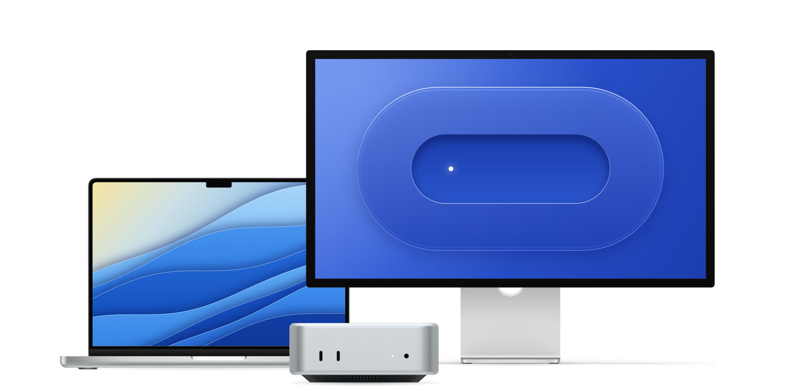

# Device render



A laptop, a 27-inch display and a desktop mini on a white background, with animated screens, rendered to a still and an 8-second video. This folder is repo-only: it is not part of the skill package.

| File | What it is |
|---|---|
| `scene.html` | The composition: the two device frames from `assets/`, the screen animations drawn on canvases inside their screen openings, and the desktop mini rendered with three.js |
| `devices.js` | The desktop mini model, 12.7 x 12.7 x 5.0 cm with its slotted base, and the aluminium material |
| `render.mjs` | Opens the scene in headless Chromium, captures frames at a fixed time step and encodes them with ffmpeg |
| `assets/` | The device frame images; see `NOTICE.md` |
| `preview.jpg` | A 1920-pixel preview of the still |
| `output/` | The current renders: `devices-4k.png` (3840 x 1906) and `devices-8s.mp4` (2560 x 1270, 30 fps, H.264) |

## Render

Needs Node.js 22 or newer and ffmpeg with libx264 on `PATH`.

```sh
npm install
npx playwright install chromium
npm run still
npm run video
```

Both write to `output/` by default; pass another folder as the second argument to `node render.mjs`. `T=6 npm run still` renders the still at another time, `W=2560 npm run video` renders the video frames at a lower width. Every frame is a pure function of its time, so a render repeated on the same machine is byte-identical.

## Layout

The placement and the scale of each device follow the reference composition: the display at 1.0, the laptop at 1.28 and the desktop mini at 1.77 relative to real size. The desktop mini's ports, status light and base follow measurements taken from a front view: two USB-C ports at -3.67 cm and -2.19 cm, the light at +2.42 cm and the headphone jack at +3.61 cm from the centre, all 1.6 cm above the bottom of the body; the base is a truncated cone 10.7 cm across at the top and 9.2 cm at the bottom with 118 slots.
